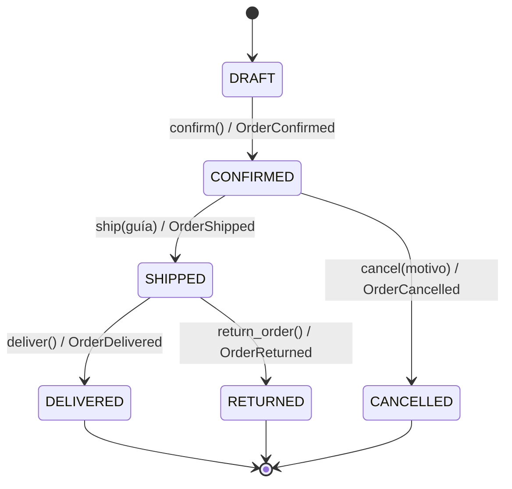

# Bitácora TechStore U4 — Escenarios E01–E15

Resultados reales generados con `python ejecutar_escenarios.py --md docs/BITACORA.md`. Cada escenario parte de fixtures recién cargados; no se editaron pedidos ni reglas.

**Resumen:** 15/15 escenarios coinciden con el objetivo de `escenarios.csv`.

## 1. Carga de datos (`python cargar_csv.py`)

```text
O001 DRAFT 4 2100.00
O002 DRAFT 2 1050.00
O003 DRAFT 4 2100.00
O004 DRAFT 1 850.00
O005 DRAFT 4 2100.00
O006 DRAFT 1 18000.00
O007 DRAFT 0 0.00
O008 DRAFT 20 2400.00
O009 DRAFT 19 2280.00
O010 DRAFT 2 500.00
O011 DRAFT 3 1500.00
O012 DRAFT 1 850.00
O013 DRAFT 1 600.00
O014 DRAFT 1 600.00
O015 DRAFT 1 450.00
O016 DRAFT 1 2100.00
```

> Captura pendiente: pantallazo de la terminal con estos 16 pedidos en DRAFT.

## 2. Actividad corta (cálculo manual)

| Pedido | Cliente | Unidades | Total manual |
| --- | --- | --- | --- |
| O001 | C001 (VIP) | 4 (2×SKU001 + 2×SKU002) | 2×600 + 2×450 = **2100.00** |
| O006 | C006 | 1 (1×SKU008) | **18000.00** |
| O010 | C010 | 2 (SKU003 + SKU009) | 120 + 380 = **500.00** |

## 3. Resumen de escenarios

| Caso | Pedido | Acción | Esperado | ¿Coincide? |
| --- | --- | --- | --- | --- |
| E01 | O001 | evaluar_descuento | 10% | ✅ |
| E02 | O002 | evaluar_descuento | 0% | ✅ |
| E03 | O003 | confirmar | rechazo | ✅ |
| E04 | O005 | evaluar_descuento | 0% | ✅ |
| E05 | O006 | evaluar_descuento | 5% | ✅ |
| E06 | O007 | confirmar | rechazo | ✅ |
| E07 | O008 | confirmar | exito | ✅ |
| E08 | O009 | agregar SKU003 x2 | rechazo | ✅ |
| E09 | O010 | evaluar_descuento | 0% | ✅ |
| E10 | O011 | evaluar_descuento | 0% | ✅ |
| E11 | O012 | confirmar y enviar sin guia | rechazo envio | ✅ |
| E12 | O013 | confirmar dos veces | rechazo segunda | ✅ |
| E13 | O014 | confirmar, enviar y cancelar | rechazo cancelacion | ✅ |
| E14 | O015 | confirmar, enviar y devolver | exito | ✅ |
| E15 | O016 | confirmar, enviar y entregar | exito | ✅ |

## 4. Bitácora detallada

### E01 — O001 · evaluar_descuento → 10%

- **Precondiciones (estado inicial):** DRAFT; cliente C001 (VIP, activo); 4 uds; total 2100.00 MXN; promoción no
- **Operación:** `discount_rate(order) / discount_amount(order)`
- **Resultado real:** tasa 10%, descuento 210.00, neto 1890.00; estado DRAFT
- **Evento:** Ninguno (consulta: no cambia el estado)
- **Explicación:** Cumple las 4 condiciones del 10 %: VIP, 2100.00 > 500, 4 ≥ 4 unidades y sin promoción.
- **API equivalente:** GET /orders/O001/discount → 200 tasa 0.10
- **Prueba:** `tests/test_escenarios.py::test_e01_descuento_vip_10`

### E02 — O002 · evaluar_descuento → 0%

- **Precondiciones (estado inicial):** DRAFT; cliente C002 (no VIP, activo); 2 uds; total 1050.00 MXN; promoción no
- **Operación:** `discount_rate(order) / discount_amount(order)`
- **Resultado real:** tasa 0%, descuento 0.00, neto 1050.00; estado DRAFT
- **Evento:** Ninguno (consulta: no cambia el estado)
- **Explicación:** C002 no es VIP (falla la regla de 10 %) y 1050.00 no supera 5000 (falla la de 5 %).
- **API equivalente:** GET /orders/O002/discount → 200 tasa 0
- **Prueba:** `tests/test_escenarios.py::test_e02_no_vip_sin_descuento`

### E03 — O003 · confirmar → rechazo

- **Precondiciones (estado inicial):** DRAFT; cliente C003 (VIP, inactivo); 4 uds; total 2100.00 MXN; promoción no
- **Operación:** `confirm()`
- **Resultado real:** confirm() → InvalidOrderData: Requiere artículos y cliente activo | estado final DRAFT
- **Evento:** Ninguno (operación rechazada)
- **Explicación:** C003 es VIP pero está inactivo: confirm() valida antes de cambiar el estado y no emite evento.
- **API equivalente:** POST /orders/O003/confirm → 422
- **Prueba:** `tests/test_escenarios.py::test_e03_cliente_inactivo_rechaza_confirmacion`

### E04 — O005 · evaluar_descuento → 0%

- **Precondiciones (estado inicial):** DRAFT; cliente C005 (VIP, activo); 4 uds; total 2100.00 MXN; promoción sí
- **Operación:** `discount_rate(order) / discount_amount(order)`
- **Resultado real:** tasa 0%, descuento 0.00, neto 2100.00; estado DRAFT
- **Evento:** Ninguno (consulta: no cambia el estado)
- **Explicación:** C005 es VIP, 4 unidades y 2100.00, pero la promoción activa bloquea ambos descuentos (~ActivePromotionSpec).
- **API equivalente:** GET /orders/O005/discount → 200 tasa 0
- **Prueba:** `tests/test_escenarios.py::test_e04_promocion_activa_bloquea_descuento`

### E05 — O006 · evaluar_descuento → 5%

- **Precondiciones (estado inicial):** DRAFT; cliente C006 (no VIP, activo); 1 uds; total 18000.00 MXN; promoción no
- **Operación:** `discount_rate(order) / discount_amount(order)`
- **Resultado real:** tasa 5%, descuento 900.00, neto 17100.00; estado DRAFT
- **Evento:** Ninguno (consulta: no cambia el estado)
- **Explicación:** 18000.00 > 5000 y sin promoción cumple el 5 %; C006 no es VIP, por eso no alcanza el 10 %.
- **API equivalente:** GET /orders/O006/discount → 200 tasa 0.05
- **Prueba:** `tests/test_escenarios.py::test_e05_descuento_alternativo_5`

### E06 — O007 · confirmar → rechazo

- **Precondiciones (estado inicial):** DRAFT; cliente C007 (VIP, activo); 0 uds; total 0.00 MXN; promoción no
- **Operación:** `confirm()`
- **Resultado real:** confirm() → InvalidOrderData: Requiere artículos y cliente activo | estado final DRAFT
- **Evento:** Ninguno (operación rechazada)
- **Explicación:** Sin renglones, confirm() lanza InvalidOrderData; el pedido sigue DRAFT y no hay evento.
- **API equivalente:** POST /orders/O007/confirm → 422
- **Prueba:** `tests/test_escenarios.py::test_e06_pedido_vacio_rechaza_confirmacion`

### E07 — O008 · confirmar → exito

- **Precondiciones (estado inicial):** DRAFT; cliente C008 (no VIP, activo); 20 uds; total 2400.00 MXN; promoción no
- **Operación:** `confirm()`
- **Resultado real:** confirm() → OK | estado final CONFIRMED
- **Evento:** OrderConfirmed
- **Explicación:** 20 unidades es el máximo permitido (solo > 20 se rechaza); el pedido se confirma.
- **API equivalente:** POST /orders/O008/confirm → 200
- **Prueba:** `tests/test_escenarios.py::test_e07_20_unidades_permitidas_y_confirma`

### E08 — O009 · agregar SKU003 x2 → rechazo

- **Precondiciones (estado inicial):** DRAFT; cliente C009 (VIP, activo); 19 uds; total 2280.00 MXN; promoción no
- **Operación:** `add_item(OrderItem('SKU003', 2, 120.00))`
- **Resultado real:** add_item(SKU003 × 2) → OrderItemLimitExceeded: Máximo 20 unidades; uds=19
- **Evento:** Ninguno (operación rechazada)
- **Explicación:** 19 + 2 = 21 > 20: add_item() detiene la operación antes de modificar items. Se suman unidades, no renglones.
- **API equivalente:** POST /orders/O009/items → 422
- **Prueba:** `tests/test_escenarios.py::test_e08_21_unidades_exceden_limite`

### E09 — O010 · evaluar_descuento → 0%

- **Precondiciones (estado inicial):** DRAFT; cliente C010 (no VIP, activo); 2 uds; total 500.00 MXN; promoción no
- **Operación:** `discount_rate(order) / discount_amount(order)`
- **Resultado real:** tasa 0%, descuento 0.00, neto 500.00; estado DRAFT
- **Evento:** Ninguno (consulta: no cambia el estado)
- **Explicación:** El total 500.00 no supera 500 (umbral estricto >). Nota: C010 no es VIP y tiene 2 unidades, así que este pedido solo no aísla la frontera; la frontera se prueba con VIP y 4 unidades en test_frontera_monto_estricto_con_vip_y_4_unidades.
- **API equivalente:** GET /orders/O010/discount → 200 tasa 0
- **Prueba:** `tests/test_escenarios.py::test_e09_umbral_estricto_500`

### E10 — O011 · evaluar_descuento → 0%

- **Precondiciones (estado inicial):** DRAFT; cliente C011 (VIP, activo); 3 uds; total 1500.00 MXN; promoción no
- **Operación:** `discount_rate(order) / discount_amount(order)`
- **Resultado real:** tasa 0%, descuento 0.00, neto 1500.00; estado DRAFT
- **Evento:** Ninguno (consulta: no cambia el estado)
- **Explicación:** C011 es VIP y 1500.00 > 500, pero 3 unidades < 4: falla MinimumUnitsSpec(4).
- **API equivalente:** GET /orders/O011/discount → 200 tasa 0
- **Prueba:** `tests/test_escenarios.py::test_e10_vip_con_3_unidades_sin_descuento`

### E11 — O012 · confirmar y enviar sin guia → rechazo envio

- **Precondiciones (estado inicial):** DRAFT; cliente C012 (no VIP, activo); 1 uds; total 850.00 MXN; promoción no
- **Operación:** `confirm() → ship('')`
- **Resultado real:** confirm() → OK | ship('') → InvalidOrderData: El envío requiere número de guía | estado final CONFIRMED
- **Evento:** OrderConfirmed
- **Explicación:** La confirmación es válida; ship('') lanza InvalidOrderData. Sigue CONFIRMED y no se emite OrderShipped.
- **API equivalente:** POST /orders/O012/confirm → 200 ; POST /orders/O012/ship → 422
- **Prueba:** `tests/test_escenarios.py::test_e11_envio_sin_guia_rechazado`

### E12 — O013 · confirmar dos veces → rechazo segunda

- **Precondiciones (estado inicial):** DRAFT; cliente C001 (VIP, activo); 1 uds; total 600.00 MXN; promoción no
- **Operación:** `confirm() → confirm() 2.ª vez`
- **Resultado real:** confirm() → OK | confirm() 2.ª vez → InvalidOrderTransition: Solo DRAFT puede confirmarse | estado final CONFIRMED
- **Evento:** OrderConfirmed
- **Explicación:** La segunda confirmación lanza InvalidOrderTransition (solo DRAFT confirma) y no agrega un segundo evento.
- **API equivalente:** POST /orders/O013/confirm → 200 ; POST /orders/O013/confirm → 409
- **Prueba:** `tests/test_escenarios.py::test_e12_segunda_confirmacion_rechazada`

### E13 — O014 · confirmar, enviar y cancelar → rechazo cancelacion

- **Precondiciones (estado inicial):** DRAFT; cliente C002 (no VIP, activo); 1 uds; total 600.00 MXN; promoción no
- **Operación:** `confirm() → ship('TRK-O014') → cancel('Cliente ya no lo quiere')`
- **Resultado real:** confirm() → OK | ship('TRK-O014') → OK | cancel('Cliente ya no lo quiere') → InvalidOrderTransition: Solo CONFIRMED puede cancelarse | estado final SHIPPED
- **Evento:** OrderConfirmed, OrderShipped
- **Explicación:** cancel() exige CONFIRMED; desde SHIPPED lanza InvalidOrderTransition y no emite OrderCancelled.
- **API equivalente:** POST /orders/O014/confirm → 200 ; POST /orders/O014/ship → 200 ; POST /orders/O014/cancel → 409
- **Prueba:** `tests/test_escenarios.py::test_e13_cancelacion_desde_shipped_rechazada`

### E14 — O015 · confirmar, enviar y devolver → exito

- **Precondiciones (estado inicial):** DRAFT; cliente C005 (VIP, activo); 1 uds; total 450.00 MXN; promoción no
- **Operación:** `confirm() → ship('TRK-O015') → return_order()`
- **Resultado real:** confirm() → OK | ship('TRK-O015') → OK | return_order() → OK | estado final RETURNED
- **Evento:** OrderConfirmed, OrderShipped, OrderReturned
- **Explicación:** SHIPPED permite return_order(): estado final RETURNED y tres eventos en orden.
- **API equivalente:** POST /orders/O015/confirm → 200 ; POST /orders/O015/ship → 200 ; POST /orders/O015/return → 200
- **Prueba:** `tests/test_escenarios.py::test_e14_devolucion_termina_returned`

### E15 — O016 · confirmar, enviar y entregar → exito

- **Precondiciones (estado inicial):** DRAFT; cliente C007 (VIP, activo); 1 uds; total 2100.00 MXN; promoción no
- **Operación:** `confirm() → ship('TRK-O016') → deliver()`
- **Resultado real:** confirm() → OK | ship('TRK-O016') → OK | deliver() → OK | estado final DELIVERED
- **Evento:** OrderConfirmed, OrderShipped, OrderDelivered
- **Explicación:** SHIPPED permite deliver(): estado final DELIVERED y tres eventos en orden.
- **API equivalente:** POST /orders/O016/confirm → 200 ; POST /orders/O016/ship → 200 ; POST /orders/O016/deliver → 200
- **Prueba:** `tests/test_escenarios.py::test_e15_entrega_termina_delivered`

## 5. Máquina de estados



| Método | Estado requerido | Validación adicional | Evento | Estado nuevo |
| --- | --- | --- | --- | --- |
| `confirm()` | DRAFT | ≥ 1 artículo y cliente activo | OrderConfirmed | CONFIRMED |
| `ship(guía)` | CONFIRMED | guía no vacía | OrderShipped | SHIPPED |
| `cancel(motivo)` | CONFIRMED | motivo no vacío | OrderCancelled | CANCELLED |
| `deliver()` | SHIPPED | — | OrderDelivered | DELIVERED |
| `return_order()` | SHIPPED | — | OrderReturned | RETURNED |

**Domain Events.** Un evento es un hecho ya ocurrido en el dominio (`DomainEvent`: nombre, `order_id`, fecha UTC y detalle). Cada método sigue el orden *validar → cambiar estado → registrar evento*, así que un evento solo existe si la transición fue válida: una operación rechazada no deja rastro (E03, E06, E11, E12, E13). La lista `order.events` queda como historial auditable y es el punto donde después se podría notificar a otros componentes.

## 6. Evidencia de la API (`/docs`)

| Caso | Petición | HTTP | Respuesta |
| --- | --- | --- | --- |
| Éxito | `POST /orders/O013/confirm` | 200 | `{'id': 'O013', 'status': 'CONFIRMED'}` |
| Rechazo: estado | `POST /orders/O013/confirm` | 409 | `{'detail': 'Solo DRAFT puede confirmarse'}` |
| Rechazo: no existe | `POST /orders/NOEXISTE/confirm` | 404 | `{'detail': 'No existe'}` |
| Rechazo: sin artículos | `POST /orders/O007/confirm` | 422 | `{'detail': 'Requiere artículos y cliente activo'}` |

Mapeo de errores: `InvalidOrderTransition` → 409; `InvalidOrderData` y `OrderItemLimitExceeded` → 422; pedido o SKU inexistente → 404.

> Capturas pendientes en Swagger (`uvicorn app.api:app --reload` → `/docs`): una operación exitosa (`POST /orders/O013/confirm` → 200) y una rechazada (repetirla → 409).

## 7. Resultado de pytest (`python -m pytest -q`)

```text
........................................................................ [ 93%]
.....                                                                    [100%]
77 passed in 0.48s
```
